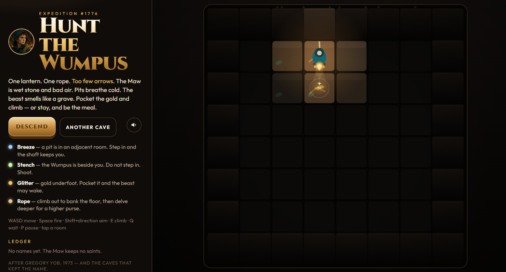
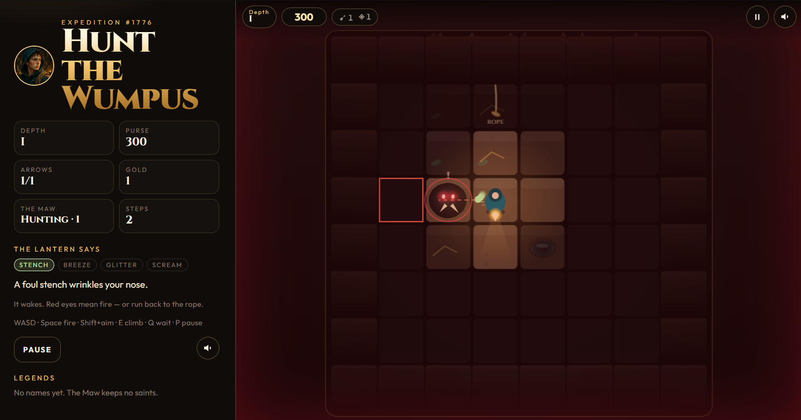
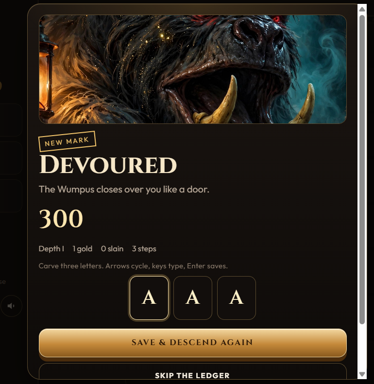

# 🐉 Hunt the Wumpus

An interactive, browser-based Wumpus World adventure game built using React, TypeScript, and Vite.

Explore mysterious caves, avoid deadly pits, hunt the Wumpus, collect hidden gold, and survive as you descend deeper into the dungeon.

## 🎮 About the Project

Hunt the Wumpus is inspired by the classic Wumpus World problem from Artificial Intelligence.

Players explore a dangerous cave system where they must use environmental clues to identify nearby hazards and make strategic decisions.

Every move matters. One wrong step could lead to a deadly pit or the Wumpus!

## ✨ Features

* Interactive cave exploration.
* Wumpus monster and deadly pit hazards.
* Environmental clues:

  * **Stench:** Indicates a nearby Wumpus.
  * **Breeze:** Indicates a nearby pit.
  * **Glitter:** Indicates gold in the current room.
  * **Scream:** Indicates that the Wumpus has been eliminated.
* Arrow-based combat mechanics.
* Gold collection and scoring system.
* Multiple cave layouts.
* Increasing exploration depth.
* Pause and resume functionality.
* Sound effects with mute controls.
* Leaderboard and score tracking.
* Keyboard and touch-based controls.

## 🛠️ Tech Stack

| Technology   | Purpose                           |
| ------------ | --------------------------------- |
| React        | User interface                    |
| TypeScript   | Application logic and type safety |
| Vite         | Development server and build tool |
| Tailwind CSS | Styling                           |
| HTML5 Canvas | Game rendering                    |
| CSS          | Visual design and animations      |

## 🎯 How to Play

Your objective is to explore the cave, collect gold, eliminate the Wumpus, and survive.

### Game Clues

| Clue    | Meaning                      |
| ------- | ---------------------------- |
| Stench  | The Wumpus is nearby         |
| Breeze  | A pit is nearby              |
| Glitter | Gold is in your current room |
| Scream  | The Wumpus has been killed   |

### Keyboard Controls

| Key               | Action                                       |
| ----------------- | -------------------------------------------- |
| W / ↑             | Move North                                   |
| A / ←             | Move West                                    |
| S / ↓             | Move South                                   |
| D / →             | Move East                                    |
| Space             | Fire Arrow                                   |
| Shift + Direction | Aim and Fire                                 |
| E / Enter / C     | Climb                                        |
| Q                 | Wait                                         |
| P / Esc           | Pause                                        |
| M                 | Toggle Sound                                 |
| R                 | Restart / Reshuffle, depending on game state |

You can also interact with the cave using mouse or touch controls.

## 📸 Screenshots

### Main Menu


### Gameplay


### Game Over


## 💻 Installation and Setup

Follow these steps to run the project locally.

### Prerequisites

* Node.js
* npm
* Git

### 1. Clone the repository

```bash
git clone https://github.com/saliankishan/wumpus-world-game.git
```

### 2. Navigate to the project directory

```bash
cd wumpus-world-game
```

### 3. Install dependencies

```bash
npm install
```

### 4. Start the development server

```bash
npm run dev
```

### 5. Open in your browser

Visit the local URL displayed in your terminal, usually:

```text
http://localhost:5173/
```

## 🏗️ Build for Production

To generate an optimized production build:

```bash
npm run build
```

To preview the production build locally:

```bash
npm run preview
```

## 📁 Project Structure

```text
wumpus-world-game/
│
├── src/
│   ├── assets/
│   ├── game/
│   │   ├── audio.ts
│   │   ├── dirs.ts
│   │   ├── format.ts
│   │   ├── generate.ts
│   │   ├── render.ts
│   │   ├── scores.ts
│   │   ├── sim.ts
│   │   └── types.ts
│   │
│   ├── utils/
│   ├── App.tsx
│   ├── index.css
│   └── main.tsx
│
├── index.html
├── package.json
├── package-lock.json
├── tsconfig.json
├── vite.config.ts
└── README.md
```

## 🚀 Future Improvements

* Online multiplayer mode.
* Additional difficulty levels.
* More cave environments.
* Enhanced AI-based game strategies.
* Global online leaderboard.

## 👨‍💻 Author

**Kishan D Salian**

GitHub: https://github.com/saliankishan

---

If you enjoy the project, consider giving the repository a ⭐!
